# Debugging a React App with React Developer Tools

This checkpoint walks through debugging a small React **Task Manager** app with the **React Developer Tools**. The app has several components that use state and pass props to each other. It started out with **6 bugs**. For each bug, this README covers:

1. **Symptom**: what goes wrong on screen
2. **Investigation**: how React DevTools exposes it (with a screenshot)
3. **Root cause**: the faulty line of code
4. **Fix**: the corrected code
5. **Verification**: a screenshot after the fix

---

## Table of contents

- [Project structure](#project-structure)
- [Setup](#setup)
- [Installing React Developer Tools](#installing-react-developer-tools)
- [The component tree](#the-component-tree)
- [Debugging scenario](#debugging-scenario)
  - [Bug 1: Missing title (misspelled prop)](#bug-1-header-title-is-missing-misspelled-prop)
  - [Bug 2: List says "No tasks" (wrong prop name)](#bug-2-the-list-says-no-tasks-yet-wrong-prop-name)
  - [Bug 3: Checkbox doesn't toggle (state mutation)](#bug-3-checking-a-task-does-nothing-state-mutation)
  - [Bug 4: Total shows "62h" (string state)](#bug-4-total-estimate-shows-62h-incorrect-state-type)
  - [Bug 5: Missing `key` warning](#bug-5-each-child-in-a-list-should-have-a-unique-key-warning)
  - [Bug 6: Delete removes the wrong tasks](#bug-6-deleting-a-task-deletes-all-the-other-ones)
- [Final verification](#final-verification)
- [Summary of fixes](#summary-of-fixes)
- [React DevTools features used](#react-devtools-features-used)

---

## Project structure

```
Checkpoint Debugging React/
├── buggy-version/src/        ← original code WITH the bugs (kept for reference)
├── docs/screenshots/         ← screenshots used in this README
├── src/                      ← FIXED code (each fix is marked with a "// FIX #n" comment)
│   ├── App.jsx               ← owns the `tasks` state, passes props down
│   ├── main.jsx
│   ├── index.css
│   └── components/
│       ├── Header.jsx        ← props: title
│       ├── AddTaskForm.jsx   ← local state: title, hours | props: onAdd
│       ├── TaskList.jsx      ← props: tasks, onToggle, onDelete
│       ├── TaskItem.jsx      ← props: task, onToggle, onDelete
│       └── Stats.jsx         ← props: tasks (derived: completed count, total hours)
├── index.html
├── package.json
└── vite.config.js
```

## Setup

Requirements: **Node.js 18+** and npm.

```bash
npm install
npm run dev
```

Then open **http://localhost:5173**.

> To reproduce the bugs yourself, copy `buggy-version/src` over `src` (back up `src` first). Then follow the scenario below.

## Installing React Developer Tools

| Option | How |
|---|---|
| **Chrome / Edge / Brave** | Install "React Developer Tools" from the [Chrome Web Store](https://chromewebstore.google.com/detail/react-developer-tools/fmkadmapgofadopljbjfkapdkoienihi) |
| **Firefox** | Install it from [Firefox Add-ons](https://addons.mozilla.org/firefox/addon/react-devtools/) |
| **Standalone app** (any browser, Safari, React Native) | Run `npx react-devtools`, then add `<script src="http://localhost:8097"></script>` as the **first** script in `index.html` |

After installing:

1. Open the app at `http://localhost:5173`.
2. Press **F12** to open the browser DevTools.
3. Open the **⚛️ Components** tab. There is also a **⚛️ Profiler** tab.
4. If the React icon in the toolbar is colored, it has detected a React app. In development mode the icon has a red border.

> **Note about the screenshots:** they were captured with the official React DevTools UI embedded under the app (`react-devtools-inline`). It is the same Components panel you get from the browser extension, with the app above and the panel below. One difference: this setup also lists the HTML elements (`div`, `li`, `input`…). The browser extension hides them by default (⚙️ Settings → Components → "Hide components where type equals host").

## The component tree

```
App                      state: tasks[]
├── Header               props: title
├── AddTaskForm          props: onAdd        state: title, hours
├── TaskList             props: tasks, onToggle, onDelete
│   └── TaskItem (×n)    props: task, onToggle, onDelete
└── Stats                props: tasks
```

All data lives in the `App` state (`tasks`) and flows **down** through props. Child components report actions **up** by calling the callbacks they receive (`onAdd`, `onToggle`, `onDelete`).

---

## Debugging scenario

### First look at the buggy app

The app loads, but something is clearly wrong: the header has **no title**, and the list says **"No tasks yet"**. Meanwhile, the footer says **"Completed: 1 / 3"**, so the tasks exist somewhere.

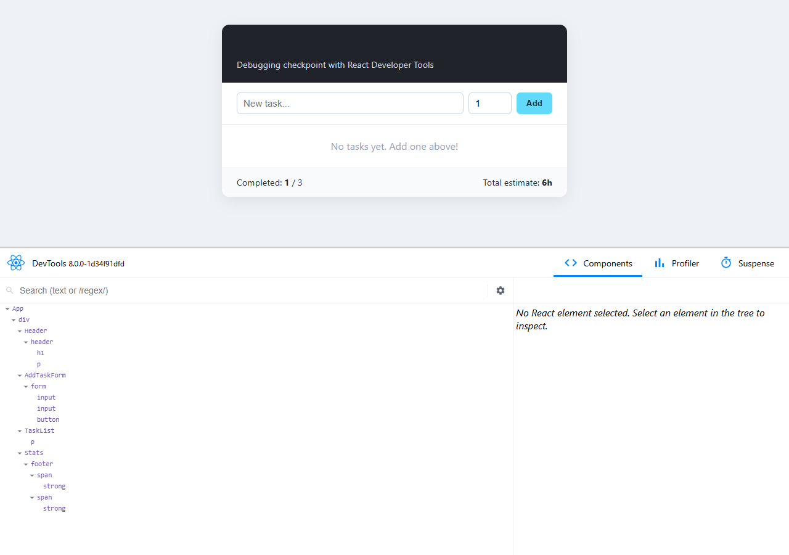

---

### Bug 1: Header title is missing (misspelled prop)

**Symptom:** The dark header bar shows only the subtitle. The `<h1>` is empty.

**Investigation with DevTools:**
1. In the **Components** tab, click **`Header`** in the tree. You can also click the "select element" icon 🔍 and then click the header on the page.
2. Read its **props** in the right panel. It receives **`tittle: "My Task Manager"`**, but the component reads `title`. That prop is missing, so it is `undefined`, and React renders nothing.

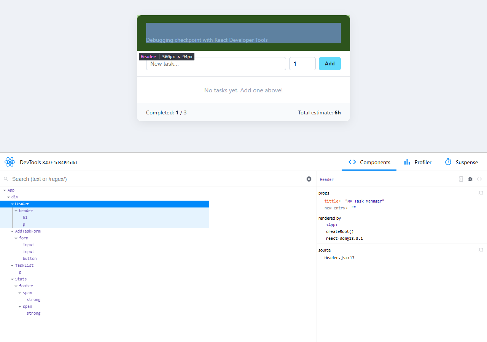

> 💡 You can check a fix live: under *props*, click **new entry**, add `title` = `"My Task Manager"`, and the heading appears immediately. This proves the diagnosis before you touch any code.

**Root cause** (`App.jsx`):
```jsx
<Header tittle="My Task Manager" />   // ❌ typo
```

**Fix:**
```jsx
<Header title="My Task Manager" />    // ✅
```

---

### Bug 2: The list says "No tasks yet" (wrong prop name)

**Symptom:** The list is empty, but the footer counts 3 tasks.

**Investigation with DevTools:**
1. Select **`TaskList`**. Its props contain `onDelete` and `onToggle`, but **no `tasks`**. Instead there is a prop called **`task`** holding the array.

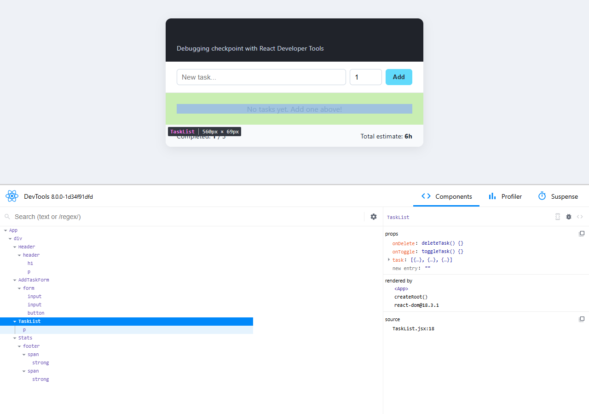

2. Select **`App`** and expand **hooks → State**. The state really does hold **3 tasks**. So the data is correct; it just gets lost on its way down to `TaskList`.

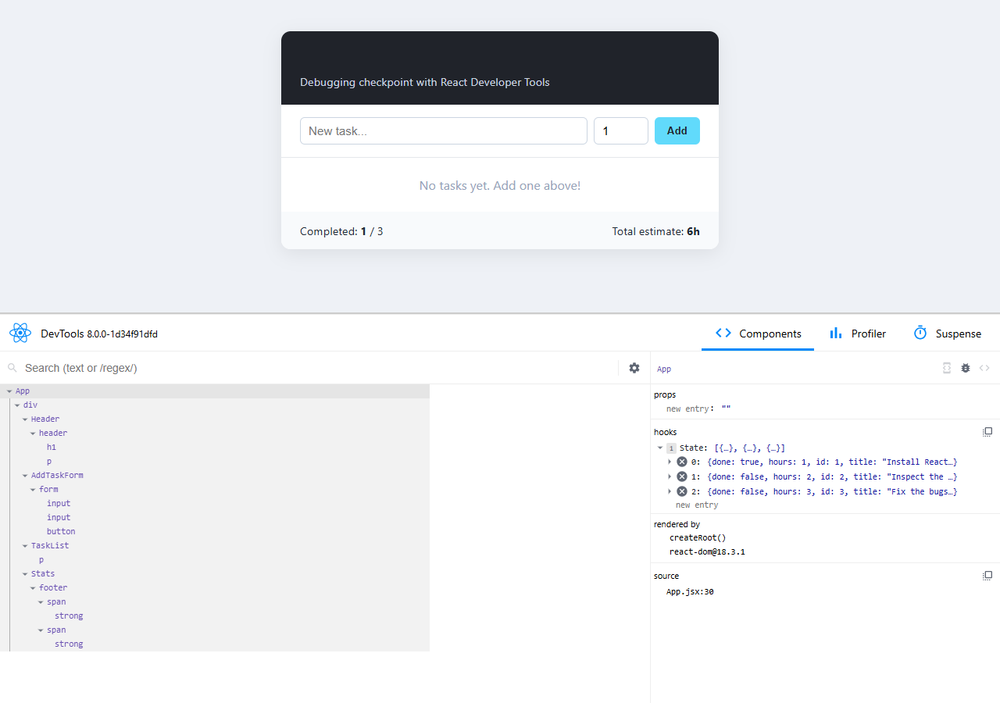

`TaskList` declares `({ tasks = [] })`. Because of the default value, the missing prop silently becomes an empty array, and the component shows "No tasks yet" instead of crashing.

**Root cause** (`App.jsx`):
```jsx
<TaskList task={tasks} ... />    // ❌ "task" ≠ "tasks"
```

**Fix:**
```jsx
<TaskList tasks={tasks} ... />   // ✅
```

With bugs 1 and 2 fixed, the title and the 3 tasks appear. Now we can test the interactions, which reveals the next bugs.

---

### Bug 3: Checking a task does nothing (state mutation)

**Symptom:** Clicking the checkbox of *"Inspect the components tree"* does nothing. The box stays unchecked, the text is not struck through, and "Completed" stays at `1 / 3`.

**Investigation with DevTools:**
1. Click the checkbox, then select **`App`** → expand **State → 1**.
2. DevTools shows **`done: true`**, but the screen still shows the task as **not done**. **The state and the UI disagree.**
3. Turn on ⚙️ **Settings → General → "Highlight updates when components render"** and click again. No highlight flashes, so **React never re-rendered**.

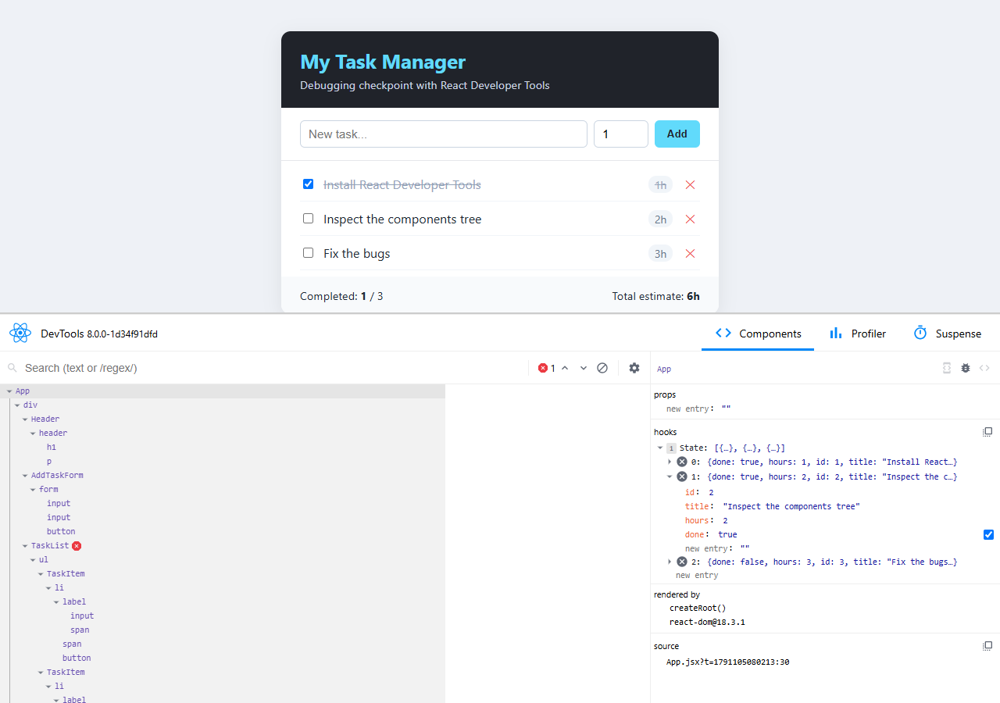

**Root cause** (`App.jsx`): the handler **mutates** the existing array and object, then passes the **same reference** to `setTasks`. React compares the old and new state with `Object.is`. The reference didn't change, so React skips the re-render.

```jsx
const toggleTask = (id) => {
  const updated = tasks;                 // ❌ same array reference
  const task = updated.find((t) => t.id === id);
  task.done = !task.done;                // ❌ mutates state directly
  setTasks(updated);                     // React sees "no change"
};
```

**Fix:** create a **new array** and a **new object** for the changed task:
```jsx
const toggleTask = (id) => {
  setTasks(tasks.map((t) => (t.id === id ? { ...t, done: !t.done } : t)));
};
```

---

### Bug 4: Total estimate shows "62h" (incorrect state type)

**Symptom:** Add the task *"Write the README"* with **2** hours. The total should become `1 + 2 + 3 + 2 = 8h`, but it shows **`62h`**.

**Investigation with DevTools:**
1. Type the task, set hours to `2`, and **before clicking Add** select **`AddTaskForm`**. Its second state hook (`hours`) is **`"2"` in quotes**, which means it is a **string**, not a number.

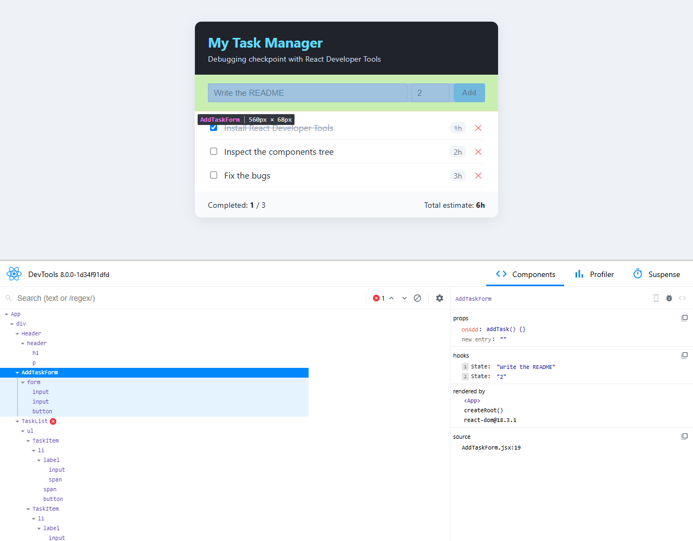

2. Click **Add**, then search for **`Stats`** with the search box and expand **props → tasks → 3**. The new task has **`hours: "2"`**, while the other tasks have numbers (`1`, `2`, `3`). In `reduce`, `6 + "2"` gives the string **`"62"`** (string concatenation instead of addition).

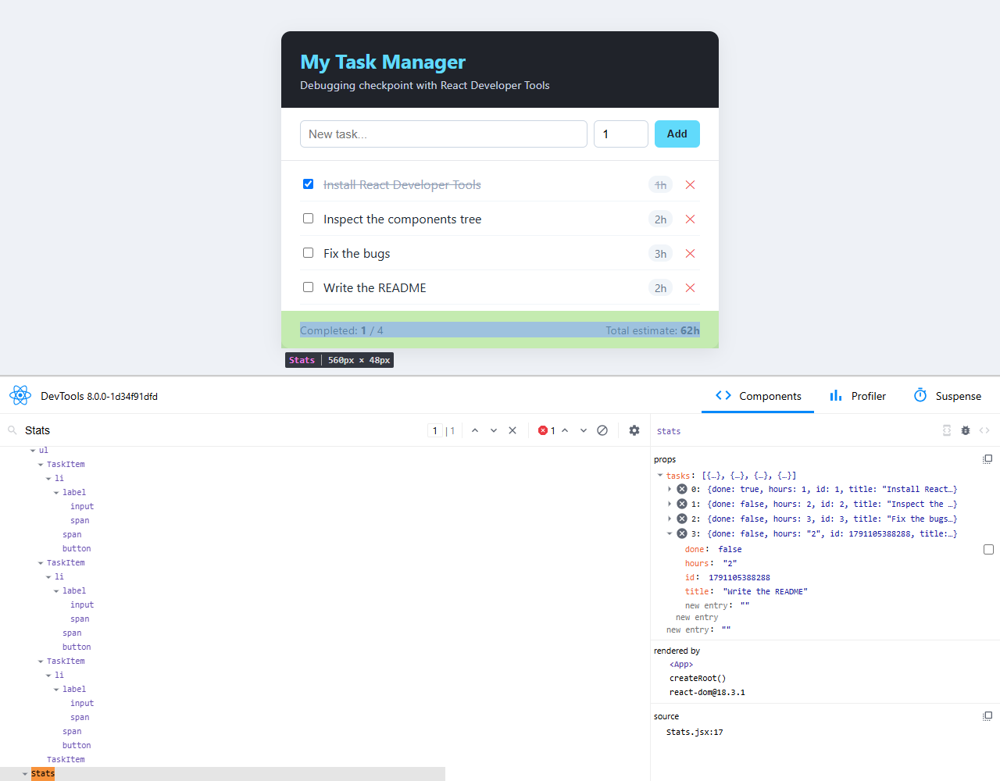

**Root cause** (`AddTaskForm.jsx`): `e.target.value` is **always a string**, even for `<input type="number">`.
```jsx
onChange={(e) => setHours(e.target.value)}           // ❌ "2"
```

**Fix:**
```jsx
onChange={(e) => setHours(Number(e.target.value))}   // ✅ 2
```

---

### Bug 5: "Each child in a list should have a unique key" warning

**Symptom:** The browser console shows this warning:
```
Warning: Each child in a list should have a unique "key" prop.
Check the render method of `TaskList`.
    at TaskItem (TaskItem.jsx)
    at TaskList (TaskList.jsx)
```

**Investigation with DevTools:** a red ❌ error badge appears next to **`TaskList`** in the tree. Select it to see the warning under **errors**. In the tree, the `TaskItem` entries have **no `key=`** label.

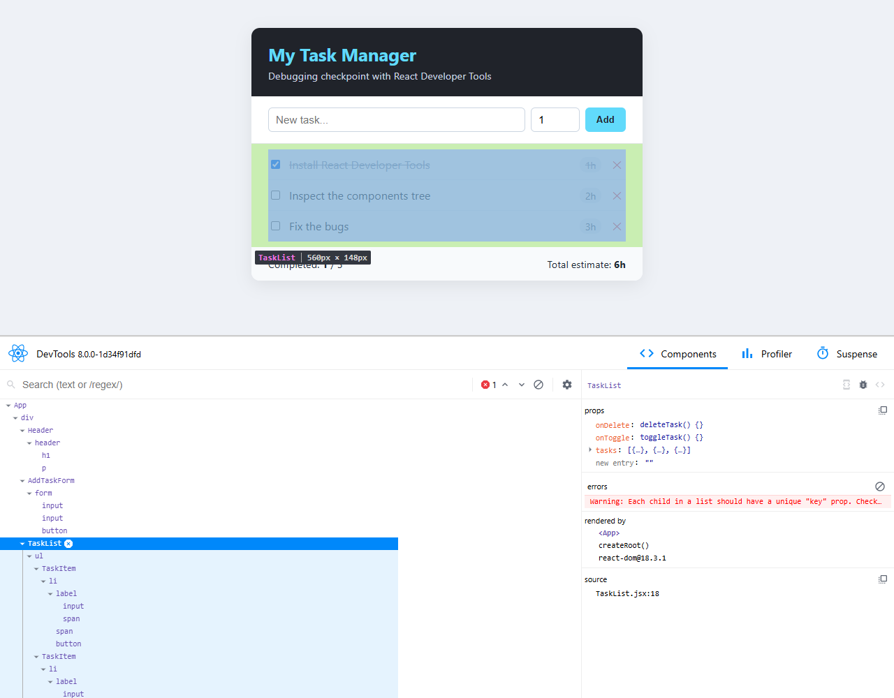

**Root cause** (`TaskList.jsx`): without keys, React can't tell which item is which when the list changes. This can lead to wrong items being updated or local state ending up on the wrong row.
```jsx
{tasks.map((task) => (
  <TaskItem task={task} ... />                 // ❌ no key
))}
```

**Fix:** use the task's stable, unique `id`. Avoid the array index, because it changes when items are deleted.
```jsx
{tasks.map((task) => (
  <TaskItem key={task.id} task={task} ... />   // ✅
))}
```

---

### Bug 6: Deleting a task deletes all the other ones

**Symptom:** Clicking ✕ on *"Fix the bugs"* removes the **other** tasks, and **only "Fix the bugs" stays**.

**Investigation with DevTools:**
1. Select a **`TaskItem`**. Its `onDelete` prop is the function **`deleteTask()`** from `App`. Its `task.id` is correct, so the child sends the right id.
2. After clicking ✕, select **`TaskList`**. Its `tasks` prop now holds **1 item**, the one we wanted to delete. Since the input was right and the output is wrong, the bug is inside `deleteTask`. Click the **`<>` (view source)** icon in the right panel to jump straight to it.

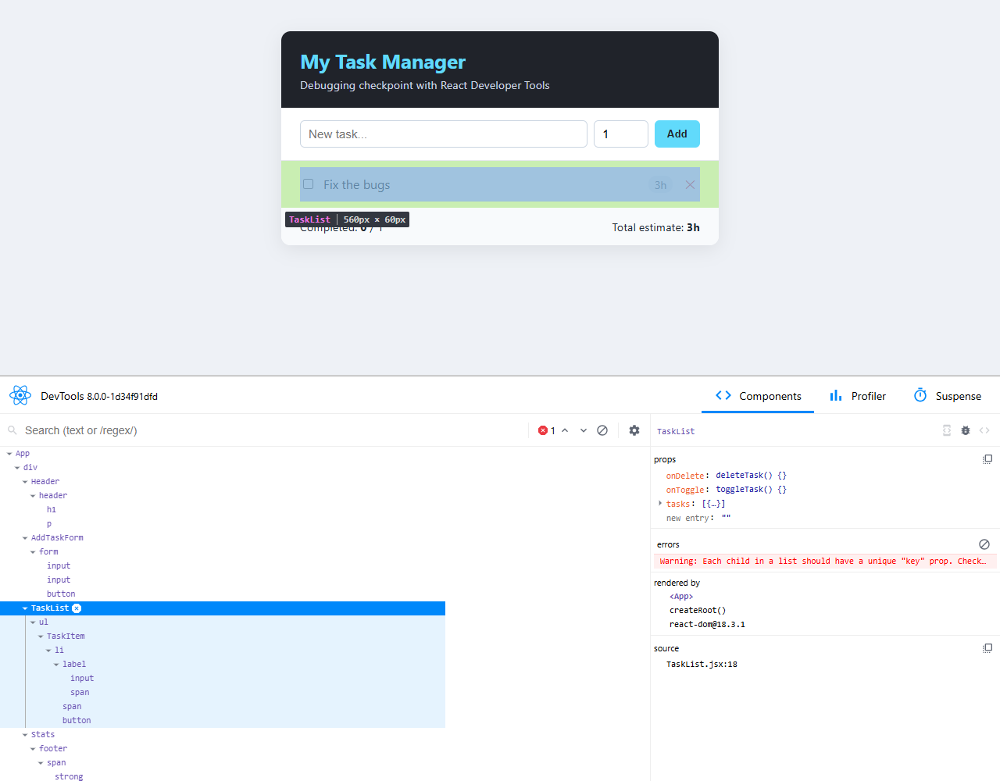

**Root cause** (`App.jsx`): the filter condition is inverted. It **keeps** only the task with the deleted id.
```jsx
setTasks(tasks.filter((t) => t.id === id));   // ❌ keeps the deleted one
```

**Fix:**
```jsx
setTasks(tasks.filter((t) => t.id !== id));   // ✅ keeps all the others
```

---

## Final verification

After applying all the fixes, I repeated each scenario with DevTools open.

**✅ Title and list render.** `Header` receives `title`, and `TaskList` receives `tasks`:

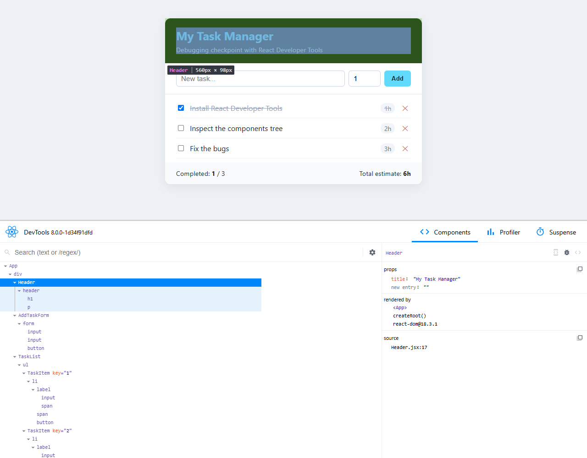

**✅ Toggling works.** The checkbox, the strike-through and "Completed: 2 / 3" all match `done: true` in the state:

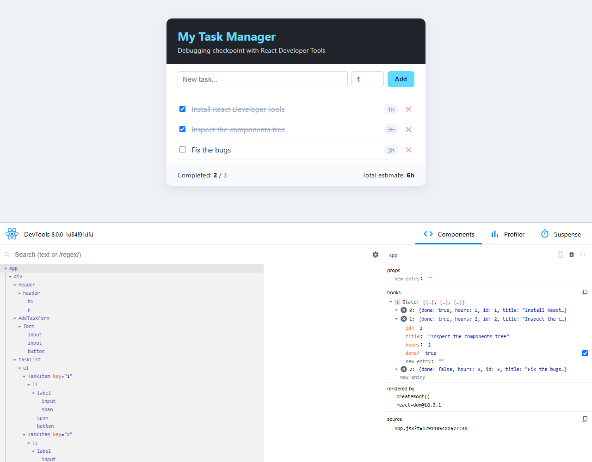

**✅ `hours` is stored as a number** (`2`, no quotes):

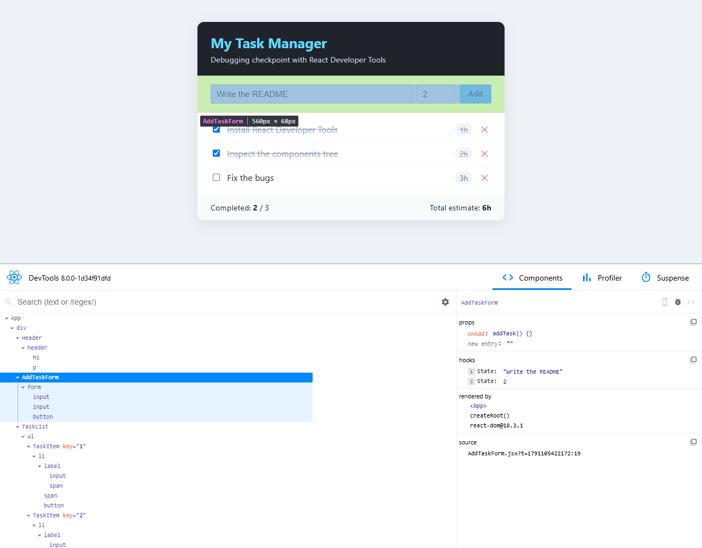

**✅ The total is correct (8h).** Each `TaskItem` now has a `key="…"`, and the error badge is gone:

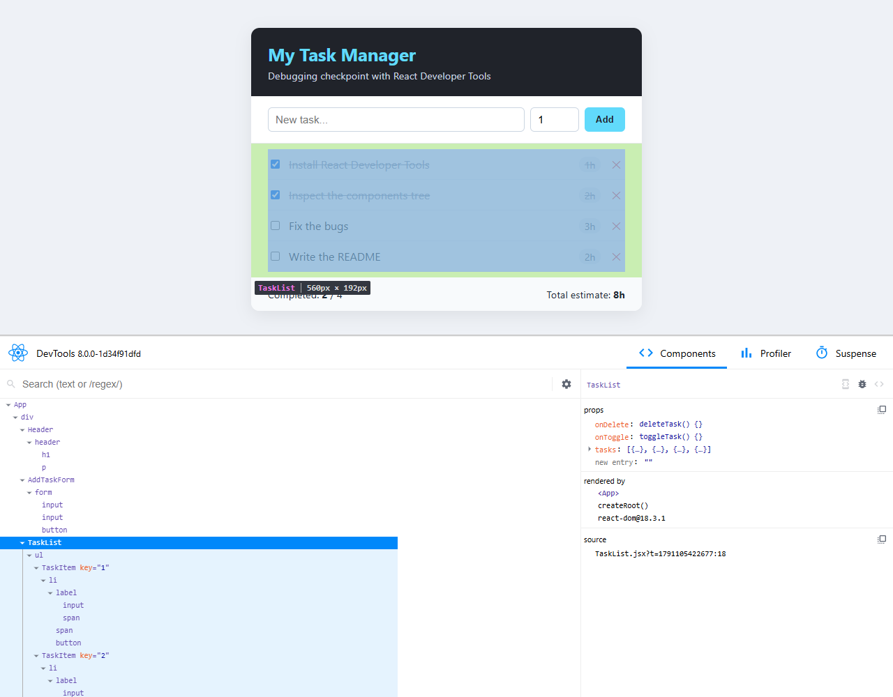

**✅ Delete removes only the clicked task.** Deleting *"Fix the bugs"* leaves the other 3 tasks, and the total drops to 5h:

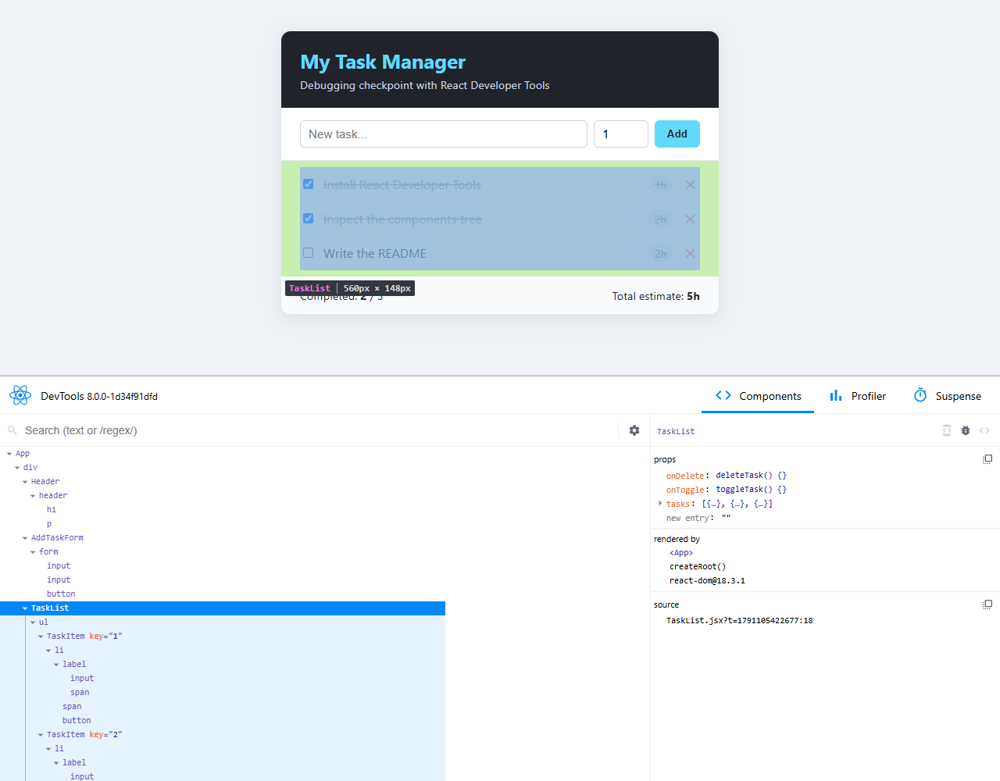

The console has no React warnings, and `npm run build` completes without errors.

## Summary of fixes

| # | Bug | Category | File | DevTools clue | Fix |
|---|-----|----------|------|---------------|-----|
| 1 | Empty header title | Missing prop (typo) | `App.jsx` | `Header` props show `tittle` | `tittle` → `title` |
| 2 | "No tasks yet" | Missing prop (wrong name) | `App.jsx` | `TaskList` props show `task`; `App` state has 3 items | `task` → `tasks` |
| 3 | Checkbox does nothing | State mutation (no re-render) | `App.jsx` | State shows `done: true` but UI unchanged; no render highlight | Immutable update with `map` + spread |
| 4 | Total "62h" | Incorrect state type | `AddTaskForm.jsx` | State `"2"` (string) | `Number(e.target.value)` |
| 5 | Key warning | Missing `key` | `TaskList.jsx` | ❌ badge on `TaskList`, no `key=` on items | `key={task.id}` |
| 6 | Delete keeps the wrong task | Logic error | `App.jsx` | `tasks` prop holds only the deleted item | `===` → `!==` |

## React DevTools features used

- **Components tree:** see the component hierarchy and who renders whom ("rendered by").
- **Select element (🔍):** click on the page to jump to the matching component.
- **Props / hooks inspector:** read live props and state. Quotes (`"2"`) reveal strings.
- **Live editing:** change props/state from DevTools to test a hypothesis before editing code.
- **Search box:** find a component by name (`Stats`, `TaskItem`…).
- **Error/warning badges:** a ❌ next to a component, with the message in the right panel.
- **Highlight updates when components render:** see whether a state change actually re-renders.
- **View source (`<>`):** jump to the component's code in the Sources tab.
- **`$r` in the console:** the selected component is available as `$r` in the browser console.
- **Profiler tab:** record interactions to see which components rendered and why.

## Lessons learned

1. **Prop names must match exactly.** A typo doesn't throw an error, it just produces `undefined`. Default values like `tasks = []` can hide the problem.
2. **Never mutate state.** Always pass a new array/object to the setter, or React may skip the re-render.
3. **Form inputs return strings.** Convert them (`Number(...)`) before storing them in state that is used for math.
4. **Lists need stable, unique keys.** Use an id, not the array index.
5. **Check the data at each level.** Comparing the `App` state, the props of the children, and the UI shows exactly where the data goes wrong.
